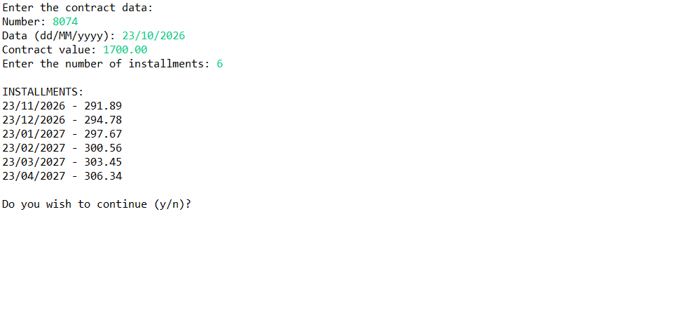

# Java Contracts and Installments

A console-based contract processing system developed in Java as part of my Java learning journey.

## About the Project

This project was developed as a practical exercise to apply Object-Oriented Programming concepts through a contract processing system.

The application registers contract information, calculates installments using an online payment service, displays the resulting installments, and saves contract data to text files.

## Features

- Register contract information
- Validate contract data
- Calculate installments based on the contract value and number of installments
- Apply interest and payment fees through a payment service
- Display contract installments
- Save contract information to text files
- Create output directories when needed
- Handle domain-specific exceptions
- Validate the number of installments

## Technologies

- Java
- Eclipse IDE

## Concepts Practiced

- Object-Oriented Programming (OOP)
- Classes and objects
- Encapsulation
- Composition and relationships between objects
- Interfaces
- Polymorphism
- Inversion of Control (IoC)
- Dependency Injection (DI)
- Separation of responsibilities
- Service and repository layers
- Exception handling
- Custom exceptions
- Date and time manipulation
- File and directory handling
- Writing data to text files using `BufferedWriter`
- Automatic resource management with try-with-resources

## Project Structure


```text

src
├── application
│   ├── ApplicationConfig.java
│   └── Program.java
│
├── application.services
│   └── ContractApplicationService.java
│
├── model.entities
│   ├── Contract.java
│   └── Installment.java
│
├── model.exceptions
│   └── DomainException.java
│
├── model.repositories
│   └── ContractRepository.java
│
├── model.services
│   ├── ContractService.java
│   ├── OnlinePaymentService.java
│   └── PaypalService.java
│
└── views
    ├── ContractUI.java
    └── InstallmentUI.java

```


## Main Entities

- `Contract` — represents a contract, stores its information, and maintains its installments.
- `Installment` — represents an individual installment, including its due date and amount.
- `DomainException` — custom exception used to represent domain-related errors.

## Main Services and Components

- `Program` — contains the main entry point and starts the application.
- `ApplicationConfig` — creates and configures the application's service and repository dependencies.
- `ContractApplicationService` — coordinates contract processing, persistence, and presentation.
- `ContractService` — processes contracts and calculates installments using a payment service.
- `OnlinePaymentService` — interface defining the online payment service contract.
- `PaypalService` — implements the payment service calculations.
- `ContractRepository` — saves contract and installment information to text files.
- `ContractUI` — handles console input and coordinates user interaction.
- `InstallmentUI` — displays the contract installments.

## Object Relationships

The project demonstrates collaboration between objects and separation of responsibilities:

- `Contract` maintains a list of `Installment` objects.
- `ContractService` depends on the `OnlinePaymentService` interface.
- `PaypalService` implements the `OnlinePaymentService` interface.
- `ApplicationConfig` creates the dependencies used by the application.
- `ContractApplicationService` coordinates the contract processing workflow.
- `ContractRepository` handles file persistence.
- `ContractUI` and `InstallmentUI` handle console interaction and presentation.

## Example of Execution

The following examples demonstrate contract processing, installment calculation, domain validation, and input validation.

### Successful Contract Processing

```text
Enter the contract data:
Number: 8047
Data (dd/MM/yyyy): 23/10/2026
Contract value: 1400.00
Enter the number of installments: 6

INSTALLMENTS:
23/11/2026 - 240.38
23/12/2026 - 242.76
23/01/2027 - 245.14
23/02/2027 - 247.52
23/03/2027 - 249.90
23/04/2027 - 252.28

Do you wish to continue (y/n)? n
```

### Domain Validation — Invalid Number of Installments

The application rejects contracts when the number of installments is zero or negative.

```text
Enter the contract data:
Number: 8001
Data (dd/MM/yyyy): 23/10/2026
Contract value: 1000.00
Enter the number of installments: 0

Error DomainException: The number of installments must be positive
```

### Input Validation — Invalid Continuation Option

The application validates the user's answer when deciding whether to continue processing contracts.

```text
Do you wish to continue (y/n)? x

Invalid answer!
Try Again!
```

### Successful Contract Processing — Multiple Installments

```text
Enter the contract data:
Number: 8049
Data (dd/MM/yyyy): 23/10/2026
Contract value: 1700.00
Enter the number of installments: 10

INSTALLMENTS:
23/11/2026 - 175.13
23/12/2026 - 176.87
23/01/2027 - 178.60
23/02/2027 - 180.34
23/03/2027 - 182.07
23/04/2027 - 183.80
23/05/2027 - 185.54
23/06/2027 - 187.27
23/07/2027 - 189.01
23/08/2027 - 190.74
```

These examples demonstrate contract registration, installment calculation using an online payment service, domain-specific exception handling, and input validation.

## Project Screenshot


## How to Run

1. Clone or download this repository.
2. Open the project in Eclipse IDE.
3. Make sure a compatible JDK is installed and configured.
4. Run `Program.java` as a Java application.
5. Follow the console instructions to enter the contract information.

Generated contract files are saved in the `output/contracts` directory relative to the application's working directory.

## Next Steps

Continue studying Java and apply new concepts through increasingly complex projects.

Future topics include:

- Collections and generics
- Set and Map
- Functional programming
- Lambda expressions and Streams
- SQL and database integration
- Spring Boot
- REST APIs
- Automated testing

## Author

**Caio Ferreira Alves**

Java and Back-End Development student, building practical projects to strengthen programming fundamentals and prepare for professional software development.

GitHub: [https://github.com/caiodevsistema](https://github.com/caiodevsistema)